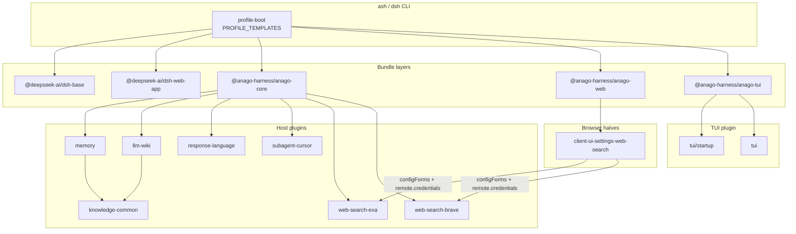
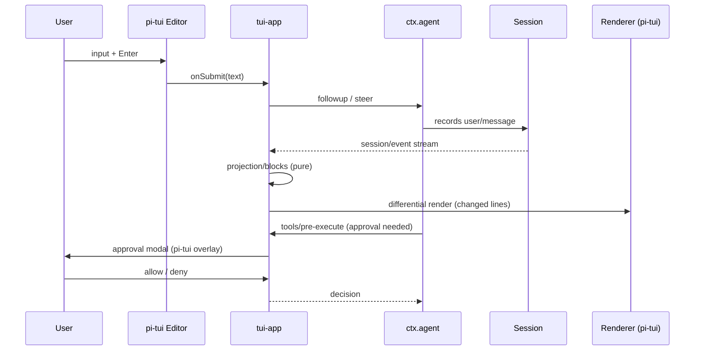

# Bundled plugin design (user plugins, search settings cards, and the pi TUI)

- Repository: `sotola122/anago-harness` (local checkout `/data_1/git_workspace/anago-harness`)
- Baseline: upstream `deepseek-ai/deepseek-harness` 0.2.1-rc.2 plus the fork commits
- Date: 2026-10-21
- Status: review copy; phases 0–7 are implemented and recorded in §15
- Related: [PROJECT_GUIDELINE.md](PROJECT_GUIDELINE.md) (the whole fork plan), [docs/fork.md](docs/fork.md) (current fork changes), `/data_1/git_workspace/dsh-plugins` (the source of the ported packages)

This document separates **facts** (verified in the checkout or the running environment), **decisions** (the requester's call), and **proposals** (this design's recommendation). When implementation changes a fact, the revision record at the end records the change.

## 1. Goals

1. Move the five packages currently installed into the `web` profile under `~/.dsh` as **external plugins** into **bundle plugins** shipped by anago-harness.
2. Make the search provider Exa by default with Brave selectable, and let a person **store both API keys from the settings screen** (the Web UI's Plugins page). The keys live in the credentials store, not in configuration files.
3. Add an **anago-harness terminal UI that inherits the pi coding agent's TUI** as a TUI plugin.

Non-goals:

- `@mars-sea/dsh-commandcode-provider` and `@deepseek-ai/dsh-subagent-claude-code` stay profile-installed (out of scope).
- Web UI branding and Japanese fonts ([PROJECT_GUIDELINE.md](PROJECT_GUIDELINE.md) §6.3/6.4), and desktop distribution (§6.6).
- Removing the DeepSeek features (§6.1) is prior work; this design stays valid after that removal.

## 2. Decisions (requester, 2026-10-21)

| Question | Decision |
|---|---|
| Bundle layout | Two bundles: `anago-core` (host) and `anago-web` (Web UI). The plugins stay plain plugins; the bundles own the rows |
| Default profiles | `web` and `headless` (leave `sdk` / `acp` / `sdk-minimal` unchanged) |
| Search provider | Keep Exa as the default and implement §6.5 first; add Brave as a selectable provider with its own card |
| TUI | Add it as a **plugin**, not an application, built on pi's TUI (`@earendil-works/pi-tui`) |

This design proposes a third bundle, `anago-tui`, so TUI rows never land in the Web profile (chapter 4). It extends the two-bundle decision without changing the ownership rule.

### 2.1 Further decisions (requester, 2026-10-21)

| Question | Decision |
|---|---|
| `llm-wiki.global.pagesDir` | Ship `concepts` as the default, matching the current llm-wiki layout (§4.3, §7.3) |
| `response-language.enabled` | Add it (default true) so the row can be turned off without removing it (§7.4) |
| Remaining open items | As proposed: keep `subagent-cursor` in `anago-core`, leave its default model in the profile patch, default the TUI to alt-screen, keep the card fields of §5.3, pin Exa, and update `PROJECT_GUIDELINE` with phase 1 |
| Coverage policy (§8.2) | Allow file-level exclusions tagged `TODO(fork)`, shrinking only; do not require 100% on day one. Each phase proves 100% on the files it adds and a non-increasing exclusion count |
| Snapshot compatibility layer (§8.4) | Adopt it: one fork-only compatibility patch in the headless and web patch lists so upstream recordings replay unchanged; fork-owned scenarios re-enable rows with `disabled: false` in their own composition |

## 3. Current state (facts)

### 3.1 The running harness and the checkout

- This session runs on `~/.local/lib/node_modules/@deepseek-ai/dsh` (`@deepseek-ai/dsh@0.2.1-rc.2`), separate from the fork checkout.
- The fork checkout is 0.2.1-rc.2 plus fork commits (`fix(fork): …`, `docs: brand the fork as Anago Harness`, and others). The only fork package implemented under `packages/fork/` is `@anago-harness/fork-policy`.
- `@anago-harness/fork-policy`'s `forkDefaultPatches` and `forkLockPatches` both return empty lists today (`packages/fork/fork-policy/src/index.ts`). `packages/boot/app-boot/src/profile-context.ts` splices those two functions between the bundle layers and the profile layer.

### 3.2 Installed plugins (the port sources)

The bundle list in `~/.dsh/profiles/web/package.json` is `dsh-base` / `dsh-web-app` / `commandcode-provider` / `experimental-tool-worktree` / `subagent-claude-code` / `web-search-brave` / `subagent-cursor` / `response-language` / `memory` / `llm-wiki`. The five `@tep-hardware/*` packages are the port sources.

| Current package | Inserted rows | Model- and user-facing contribution | Main dependencies |
|---|---|---|---|
| `@tep-hardware/dsh-memory` | `memory` | The `memory` tool, `/memory`, a snapshot injected from `agent/pre-step`, and a turn-end review (an auxiliary LLM call) | `dsh-agent` `dsh-tools` `dsh-commands` `dsh-user-approval` `dsh-atomic-write` `dsh-home-paths` `dsh-llm` `dsh-session` |
| `@tep-hardware/dsh-llm-wiki` | `llm-wiki` | The `wiki_write` / `wiki_search` / `wiki_lint` tools, `/wiki`, a registered skill, an `agent/pre-step` injection, and a `tools/pre-execute` guard | `dsh-tools` `dsh-skill` `dsh-commands` `dsh-agent` `dsh-llm` `dsh-session` `dsh-atomic-write` `dsh-home-paths` |
| `@tep-hardware/dsh-response-language` | `response-language` | A fixed Japanese-response instruction registered as a `systemPrompt.section` at order 9950; no configuration | `dsh-system-prompt` |
| `@tep-hardware/dsh-subagent-cursor` | `subagent-cursor` plus `tool-subagent-cursor` (`@deepseek-ai/dsh-tool-subagent`) | The `cursor` subagent provider and the `subagent_cursor` tool | `dsh-subagent` `dsh-subprocess` `dsh-timeout` `dsh-llm` `dsh-session` `dsh-tool-subagent` |
| `@tep-hardware/dsh-web-search-brave` | `web-search-brave` | Registers the `brave` search provider on `ctx.web` | `dsh-web` `dsh-credentials` `dsh-launch-environment` |
| `knowledge-common` (unscoped current name; not a plugin) | — | Knowledge-store helpers shared by memory and llm-wiki | — |

Supporting facts:

- The Brave provider already declares `Volatile<>` settings and resolves its key per search in this order: the literal `apiKey`, then `ctx.credentials.resolve(BRAVE_API_KEY)`, then the launch environment. `available()` checks only that `baseURL` parses.
- `BRAVE_API_KEY` is already stored in `~/.dsh/.credentials.yaml`.
- `/memory`, `/wiki`, and the `llm-wiki` skill are live in this session's command and skill lists.
- The global wiki repository is `~/.dsh/llm-wiki/` (`AGENTS.md`, `SCHEMA.md`, `concepts/`, `index.md`, `raw/`).

### 3.3 The fork's receiving structure

- `packages/*/*` is the unit for the pnpm workspace, tsdown, and vitest. `scripts/check-workspace-constraints.ts` treats `packages/fork/` as non-release private packages: excluded from `standardReleaseMemberDirectory`, `private: true` required, and the version must equal the root's.
- Naming follows the existing scope: `@anago-harness/*` with no `dsh-` prefix. `fork-policy` lives at `packages/fork/fork-policy`.
- `tsconfig.base.json` carries a hand-written `@anago-harness/fork-policy` alias outside the generated region. The `references` in `tsconfig.host.json` and `tsconfig.client.json` are also manual.
- Shipped profile bundle lists live in `PROFILE_TEMPLATES` (`packages/boot/app-boot/src/profile.ts`): `acp`, `web`, `headless`, `sdk`, `sdk-minimal`. There is no `tui` template.
- An existing profile keeps the bundle list it was created with, so a template change only affects new profiles. Rebuild one with `dsh rescue --from-default-profile <name>` (`apps/cli/src/args.ts`).

### 3.4 How bundles work

- A bundle carries the YAML its `package.json` `dsh.bundle.patch` names, and the profile stacks those layers in `dsh.profile.bundles` order. `insert` adds rows; a non-insert entry addressed by `id` **replaces that row's whole `config`** rather than merging (verified in PROJECT_GUIDELINE §2).
- Shipped example: `packages/bundle/base` (`@deepseek-ai/dsh-base`) sets `searchProvider: deepseek-official` and `fetchProvider: http` on the `web` row and inserts `web-search-deepseek`, `web-deepseek-api`, `web-fetch-http`, and `tool-web`.
- A single-row bundle (the plugin itself carrying `dsh.bundle.patch`) is possible, but upstream bundles follow "the bundle owns the rows, the plugins stay plain".
- A package declaring `dsh.client` has its `./client` bundle served by the client module system. **A page attaches only to the row whose specifier is the bare package name**, not a subpath (`docs/cookbook/adding-a-settings-card.md` §5).

### 3.5 Settings and credentials

- A settings namespace is the **profile row id**. Only fields declared `Volatile<>` appear in a form, and a `role('secret')` value is redacted from every response (`packages/settings/settings/README.md`).
- The browser reads and writes a namespace through `ctx.configForms.get(ns)` and registers a card into `plugins.item` only while `ctx.configForms.whileServed([ns])` reports it served. Upstream's web-search card (`packages/client/ui-settings-web-search`) edits three namespaces on one page: `web`, `web-search-deepseek`, and `web-deepseek-api`.
- Credentials go through `remote.credentials.describe([ref])` and `set(ref, value)`; a value is never read back. Stored values live in `$DSH_HOME/.credentials.yaml` (mode 600). Resolution order is stored value, then environment, then `.env` (PROJECT_GUIDELINE §6.5).

### 3.6 Exa today (important)

- Upstream's `@deepseek-ai/dsh-web-search-exa` reads only `config.apiKey ?? launchEnvironmentOf(ctx).get('EXA_API_KEY')`; it **never reads a key stored in credentials**.
- PROJECT_GUIDELINE §6.5 therefore plans a fork-side Exa provider that reads credentials (`@anago-harness/web-search-exa-credential`) and an Exa settings card (`@anago-harness/client-ui-settings-web-search-exa`).
- **Neither exists.** There is no path to enter an Exa key from the settings screen today, and no bundle mounts a `web-search-exa` row. The request's "same as Exa" is read as "the §6.5 design" (chapter 5).

### 3.7 The TUI today

- Upstream 0.2.1-rc.2 has no TUI (`web`, `headless`, `acp`, `sdk`, `sdk-minimal` only), and `PROFILE_TEMPLATES` has no `tui`.
- The local `~/.dsh/profiles/tui` came from installing the third-party `dsh-oc-tui@0.1.5` (an opencode-style TUI) with `dsh plugin`. Its bundle list is `dsh-base` plus `dsh-oc-tui` and others.
- `dsh-oc-tui` is a working example of a TUI plugin:
  - its bundle patch inserts three rows: `tui-startup` (`dsh-oc-tui/startup`), `tui-app` (`dsh-oc-tui`), and `tool-ask-user` (`@deepseek-ai/dsh-tool-ask-user`);
  - the `./startup` row parses `--resume`, `--model`, `--provider`, and `--sidebar` with `ctx.cmdlineArgs` and `parseCmdline`, then provides a `tuiStartup` service;
  - the app row creates sessions through `ctx.agents`, renders the durable session event feed, and answers the `ask_user_question` waterfall with a modal;
  - its terminal engine (`lib/term.js`) and UI (`lib/ui.js`) are its own, with `commander` as the only dependency. It is unrelated to pi's TUI.
- The DSH application-plugin seam is `@deepseek-ai/dsh-cmdline` (`ctx.cmdlineArgs`, `ctx.appReady`, `ctx.appExit`, `parseCmdline`, `exitOnStdinEnd`).

### 3.8 pi and pi-tui facts

- pi is installed under `~/.pi/agent` (`pi` resolves to `~/.pi/agent/bin/pi`; `current-version` is `1.3.0`).
- The implementation is `@earendil-works/pi-coding-agent@1.3.0` (MIT). Its TUI is a separate package, `@earendil-works/pi-tui@1.3.0`.
- `@earendil-works/pi-tui` is published on npm (1.3.0 confirmed in `registry.npmjs.org`, MIT, `engines: node >=22.19.0`, dependencies limited to `marked@18.0.11` and `get-east-asian-width@1.6.0`, about 2.4 MB unpacked).
- Capabilities: line-level differential rendering, synchronized output (CSI 2026), alt-screen and main-screen renderers, bracketed paste, mouse regions, themes, inline images (Kitty and iTerm2), and built-in components including `Editor`, `Markdown`, `SelectList`, `SettingsList`, `Loader`, `Image`, `Box`, `Container`, `VStack`, `HStack`, and `ScrollView`. Japanese cell width comes from `get-east-asian-width`.
- Native prebuilds for terminal clipboard ship for win32, darwin, and linux.
- This repository has no PTY dependency (no `node-pty`). pi-tui's own tests use `@xterm/headless`.

### 3.9 Existing verification assets (what a change affects)

- Recorded sessions: 250 scenarios under `snapshots/` (`headless` 150, `web` 64, `sdk` 26, `acp` 9, `sdk-minimal` 1). The harness boots `dsh --profile <name> --patch <base> --patch <scenario>` and compares request headers (system prompt and tool schemas) against tokenized shared sidecars (`packages/test-support/session-snapshot`).
- Coverage targets `packages/*/*/src/**` at **100% per file** (statements, branches, functions, lines). `coverage.exclude` in `vitest.config.ts` is a reviewed list of justified exceptions.
- Generated documents: `docs/config-catalog.md` (`gen-config-catalog`), `docs/tool-catalog.md` (`gen-tool-catalog`, driven by a hand-maintained boot manifest), `docs/module-graph.md` (`gen-module-graph`), and the generated client slot catalog (`gen-client-catalog` writes it under `packages/extensions/cordis-client-runner`). Every package needs a bilingual README pair with `README.i18n.yaml`, a Model Experience map entry (`scripts/doc-standard.spec.ts`, `scripts/verify-package-readme-model-experience.ts`), and a Known Limitations section (`scripts/verify-package-readme-limitations.ts`).

## 4. Target structure

### 4.1 Packages (all under `packages/fork/<dir>`, `private: true`, version equal to the root)

| Directory | npm name | Kind | Origin | Row ids |
|---|---|---|---|---|
| `memory` | `@anago-harness/memory` | Host plugin | `@tep-hardware/dsh-memory` | `memory` |
| `llm-wiki` | `@anago-harness/llm-wiki` | Host plugin | `@tep-hardware/dsh-llm-wiki` | `llm-wiki` |
| `response-language` | `@anago-harness/response-language` | Host plugin | `@tep-hardware/dsh-response-language` | `response-language` |
| `subagent-cursor` | `@anago-harness/subagent-cursor` | Host plugin | `@tep-hardware/dsh-subagent-cursor` | `subagent-cursor` |
| `subagent-pi` | `@anago-harness/subagent-pi` | Host plugin (new) | New; runs the Pi CLI as an out-of-process child | `subagent-pi` |
| `web-search-brave` | `@anago-harness/web-search-brave` | Host plugin | `@tep-hardware/dsh-web-search-brave` | `web-search-brave` |
| `web-search-exa` | `@anago-harness/web-search-exa` | Host plugin (new) | The §6.5 design | `web-search-exa` |
| `knowledge-common` | `@anago-harness/knowledge-common` | Library | `knowledge-common` (unscoped) | — |
| `web-search-credentials` | `@anago-harness/web-search-credentials` | Library (new) | Shared key lookup for both providers | — |
| `client-ui-settings-web-search` | `@anago-harness/client-ui-settings-web-search` | Client package (empty host `apply`) | §6.5 plus the Brave card, merged | `ui-settings-web-search-providers` |
| `tui` | `@anago-harness/tui` | Application plugin (exports `./startup`) | New (inherits pi-tui) | `tui-startup`, `tui-app` |
| `anago-core` | `@anago-harness/anago-core` | Bundle | New | — |
| `anago-web` | `@anago-harness/anago-web` | Bundle | New | — |
| `anago-tui` | `@anago-harness/anago-tui` | Bundle | New | — |

The Exa and Brave cards share one package and one controller, which avoids duplication (§5.2). It is fewer packages than §6.5 assumed and keeps both `jscpd` and maintenance costs down.

### 4.2 Shape



### 4.3 Bundle definitions

`packages/fork/anago-core/cordis.patch.yml`:

```yaml
# anago-core: the fork's host capabilities over dsh-base.
# The plugins stay plain plugins; this bundle owns the rows.
- insert:
    - id: memory
      name: '@anago-harness/memory'
    - id: llm-wiki
      name: '@anago-harness/llm-wiki'
      config:
        # The current knowledge repository (~/.dsh/llm-wiki) keeps its pages
        # under concepts/, so the shipped default is concepts rather than pages.
        global:
          pagesDir: concepts
    - id: response-language
      name: '@anago-harness/response-language'
      config:
        enabled: true
    - id: subagent-cursor
      name: '@anago-harness/subagent-cursor'
    - id: tool-subagent-cursor
      name: '@deepseek-ai/dsh-tool-subagent'
      config:
        provider: cursor
        toolName: subagent_cursor
        maxDepth: provider-managed
    - id: web-search-exa
      name: '@anago-harness/web-search-exa'
      config:
        apiKeyEnv: EXA_API_KEY
    - id: web-search-brave
      name: '@anago-harness/web-search-brave'
      config:
        apiKeyEnv: BRAVE_API_KEY

# The default search provider. A patch addressed by id replaces `config`
# wholesale, so `fetchProvider` is restated here.
- id: web
  name: '@deepseek-ai/dsh-web'
  config:
    searchProvider: exa
    fetchProvider: http
```

`packages/fork/anago-web/cordis.patch.yml`:

```yaml
- insert:
    # The row specifier is the bare package name, never a subpath; the client
    # module system attaches the browser half to exactly this row.
    - id: ui-settings-web-search-providers
      name: '@anago-harness/client-ui-settings-web-search'

# The upstream DeepSeek search card writes the same web.searchProvider field.
# Disable it until the DeepSeek search rows are removed
# (PROJECT_GUIDELINE §6.1).
- id: ui-settings-web-search
  name: '@deepseek-ai/dsh-client-ui-settings-web-search'
  disabled: true
```

`packages/fork/anago-tui/cordis.patch.yml`:

```yaml
- insert:
    - id: tui-startup
      name: '@anago-harness/tui/startup'
    - id: tui-app
      name: '@anago-harness/tui'
    # dsh-base mounts the user-questions service, but not the
    # ask_user_question tool; the TUI answers it through a modal.
    - id: tool-ask-user
      name: '@deepseek-ai/dsh-tool-ask-user'
```

### 4.4 Profile templates

`PROFILE_TEMPLATES` in `packages/boot/app-boot/src/profile.ts` becomes (three changed lines plus one new `tui` entry):

```ts
web: {
  bundles: ['@deepseek-ai/dsh-base', '@deepseek-ai/dsh-web-app', '@anago-harness/anago-core', '@anago-harness/anago-web'],
},
headless: {
  bundles: ['@deepseek-ai/dsh-base', '@deepseek-ai/dsh-headless', '@anago-harness/anago-core'],
},
tui: {
  bundles: ['@deepseek-ai/dsh-base', '@anago-harness/anago-core', '@anago-harness/anago-tui'],
},
```

- `anago-core` comes after the application bundle so the whole-`config` replacement reliably wins for the fork default (`searchProvider: exa`). If an application bundle later touches the `web` row, the ordering still explains the result.
- `sdk`, `acp`, and `sdk-minimal` stay unchanged so SDK expected output and ACP behavior are untouched.
- Existing profiles (for example `~/.dsh/profiles/web` on someone using this repository) do not change automatically; §9 rebuilds them.

### 4.5 Alternatives

| Option | Upside | Downside | Verdict |
|---|---|---|---|
| This design: `anago-core` plus `anago-web` plus `anago-tui` | Row ownership is centralized in bundles, each switchable on the Plugins page; matches the upstream structure | More packages | Chosen |
| Each plugin keeps its own single-row bundle (status quo) | Smallest port | Diverges from the upstream split and adds six bundles | Rejected (the decision consolidates to two) |
| Inject rows from `forkDefaultPatches` | No profile change | The rows never appear as a bundle on the Plugins page and cannot be switched off; fails the "bundle plugin" requirement | Rejected (the §6.5 Exa rows also move into a bundle) |
| One bundle for everything, TUI included | One bundle | TUI rows land in the Web profile and fight over the terminal | Rejected |

## 5. Search providers and settings cards

### 5.1 Host plugins

**Exa (new, `@anago-harness/web-search-exa`)**

- Registers a thin `WebSearchProvider` under the id `exa` that delegates to upstream's `ExaSearchProvider` (exported by `@deepseek-ai/dsh-web-search-exa`).
- Resolves the key per search in this order: the configured `apiKey` when non-empty, then `ctx.credentials.resolve(credentialRef(apiKeyEnv))`, then the `apiKeyEnv` value from `launchEnvironmentOf(ctx)`. `apiKeyEnv` defaults to `EXA_API_KEY`.
- `available()` only checks that `baseURL` passes `URL.canParse`, because the credentials read is asynchronous and unavailable at selection time — the same judgment Brave makes.
- Each search constructs `new ExaSearchProvider({ apiKey, baseURL, searchType, numResults, highlightsPerResult })` and delegates. The provider keeps no state, so concurrent searches cannot interfere.
- `Config` carries upstream's fields (`baseURL`, `searchType`, `numResults`, `highlightsPerResult`) plus `apiKey` (secret) and `apiKeyEnv` (credential reference), all `Volatile`. The settings screen never writes a secret other than through the credentials domain.

**Brave (ported, `@anago-harness/web-search-brave`)**

- The existing implementation moves unchanged: provider id `brave`, the same resolution order, the same `available()`, `Volatile` settings, and the timeout validation.
- The row id stays `web-search-brave`. Because the settings namespace is the row id, the card binds to that id.

**Duplicate ids**: mounting upstream's `@deepseek-ai/dsh-web-search-exa` alongside the fork's `web-search-exa` makes the `ctx.web` registry reject the duplicate id. The base bundle mounts no Exa provider, so this is not an issue today; anyone adding the upstream row must remove the fork row.

### 5.2 Settings cards (one package, two cards)

`@anago-harness/client-ui-settings-web-search` holds both the Exa card and the Brave card.

- Both register into the `plugins.item` slot and appear only while `ctx.configForms.whileServed(['web-search-exa'])` or `(['web-search-brave'])` reports the namespace served. Disabling the row removes its card.
- One shared controller, `WebSearchProviderCardController`, owns:
  - reading `searchProvider` from the `web` namespace, which selects the provider;
  - editing the provider's own namespace (`maxResults` and similar) through `SettingsFormModel`;
  - reading "configured" and "writable" with `remote.credentials.describe([ref])`, writing with `set(ref, value)`, never reading a value back, and re-reading on `credentials/reference-updated`.
- The two cards are views of the same `web.searchProvider` field, so selecting one automatically clears the other. The switch state is always derived from that field; a card never keeps its own copy.
- Default handling: `anago-core` sets `searchProvider: exa`. When the Exa switch is on and already matches the composed value, the card stages a reset instead of an override, following upstream's "a selection equal to the composed value clears the override" rule.
- Upstream's DeepSeek card (`ui-settings-web-search`) is mounted by web-app and writes `deepseek-search-api` into the same field. Until the DeepSeek removal lands (PROJECT_GUIDELINE §6.1) it would be a third writer, so `anago-web` sets `- id: ui-settings-web-search, disabled: true` and the fork's Web shows only the Exa and Brave cards. Remove that line once §6.1 lands.

### 5.3 Screen specification

**Exa card (label "Exa search")**

| Field | Type | Stored in | Default | Notes |
|---|---|---|---|---|
| Use Exa for web search | switch | `web.searchProvider` (`exa` or reset) | composed value `exa` | Mutually exclusive with the other card |
| API key | password (write-only) | credentials `EXA_API_KEY` | unset | The badge reports only "configured"; the hint links to the key page at dashboard.exa.ai |
| Search type | select (auto / keyword / neural) | `web-search-exa.searchType` | `auto` | |
| Results per search | number (at least 1) | `web-search-exa.numResults` | unset | An empty field returns to unset |

**Brave card (label "Brave Search")**

| Field | Type | Stored in | Default | Notes |
|---|---|---|---|---|
| Use Brave for web search | switch | `web.searchProvider` (`brave` or reset) | composed value `exa` | Mutually exclusive with the other card |
| API key | password (write-only) | credentials `BRAVE_API_KEY` | unset | The hint links to the Brave Search dashboard at api.search.brave.com |
| Results per search | number (1–20) | `web-search-brave.maxResults` | `8` | A value outside the range blocks saving and shows a localized message |
| Safe search | select (off / moderate / strict) | `web-search-brave.safesearch` | `moderate` | |

`country`, `searchLang`, `uiLang`, `baseURL`, `freshness`, and `timeoutMs` stay off the cards (they belong to the profile patch layer). Add them to a card when a deployment needs them.

### 5.4 Default value and override order

1. `anago-core` sets `web.searchProvider = exa`.
2. Choosing Brave on a card writes `searchProvider: brave` into the profile patch (the user layer). Going back to Exa clears the override so the composed `exa` shows through.
3. A `--patch` launch overlay and the home patch come later in the stack, so they win, as the existing layer order prescribes.

### 5.5 Failure display

- Searching without a key raises `WEB_PROVIDER_CREDENTIAL_MISSING` (the message names the reference, never a value). The card shows an "unset" state under the key field that matches the search-time message.
- A 401 or 403 is a `WEB_PROVIDER_ERROR` that suggests the key may be invalid or lack permission (the existing Brave wording).
- A failed save (for example a credential the domain cannot write) shows as "configured" not changing on the `describe` re-read. As in the upstream card, the Host is the only authority.

### 5.6 Card tests

- Controller unit tests: switch exclusivity, reset, `credentials.set` on key save, the `describe` race (a response for another reference is dropped), and the disabled state when the reference is not writable.
- Card rendering: the `plugins.item` registration, `whileServed` showing and hiding each card, and full locale-key coverage.
- Use `packages/client/ui-settings-web-search/tests/` (controller, card, apply) as the template.

## 6. TUI plugin (inheriting pi's TUI)

### 6.1 What is inherited and what is not

| Category | Content | Treatment |
|---|---|---|
| Inherited | Differential rendering, alt-screen and main-screen, synchronized output, bracketed paste, mouse scrolling | Use `@earendil-works/pi-tui` as-is |
| Inherited | `Editor` (multi-line, history, completion), `Markdown`, `SelectList`, `SettingsList`, `Loader`, `Image`, `Box`, `Container`, `VStack`, `HStack`, `ScrollView`, the theme interface | Use as-is |
| Inherited | pi's screen conventions (editor at the bottom, streaming block rendering, tool-result cards, status footer, `/` commands, Esc to interrupt) | Copy as design norms |
| Not inherited | `@earendil-works/pi-coding-agent` (the application), `pi-ai`, `pi-agent-core`, `pi-mcp` | Never depended on; model calls belong to DSH's `ctx.llm` and `ctx.agent` |
| Not inherited | pi's settings, session, and extension mechanisms | Use DSH settings, sessions, and plugins |

Only one package is depended on: `@earendil-works/pi-tui`. Reading pi's implementation as a reference is fine (MIT), but copying code into the fork would hurt searchability and maintenance.

### 6.2 Package layout

```
packages/fork/tui/
  package.json            # exports: "." -> lib/index.js, "./startup" -> lib/startup.js
  (no cordis.patch.yml; anago-tui owns the rows)
  src/
    startup.ts            # ./startup: command-line parsing, provides tuiStartup
    index.ts              # the app plugin (apply / Config / inject)
    app/
      root.ts             # screen composition (transcript, editor, footer, overlay)
      transcript.ts       # builds the block list
      blocks/             # user, assistant, reasoning, tool, notice, error
      editor.ts           # pi-tui Editor plus command and path completion
      footer.ts           # cwd, model, provider, tokens, cost, mode
      dialogs/            # approval, questions, model, session, settings
      theme.ts            # theme definitions (dark, light)
    projection/           # pure functions: session event -> display model
      blocks.ts
      tools.ts            # tool/result presentationMeta -> card model
      usage.ts
    host/                 # DSH service adapters
      agent.ts            # create, resume, followup, steer, abort
      approval.ts         # the approval/request waterfall
      questions.ts        # the user-questions/request waterfall
      commands.ts         # running and listing ctx.commands
      models.ts           # reading and writing agent-default-model / llm-pi-ai
      sessions.ts         # listing, deleting, and resuming stored sessions
    term/
      terminal.ts         # ProcessTerminal creation and TTY detection
      lifecycle.ts        # raw mode, SIGINT/SIGTERM, resize, exit codes
  tests/                  # projection, rendering, lifecycle, frame expectations
```

The implemented layout groups the same responsibilities a little differently (`src/app/*`, `src/projection/*`, `src/host/*`, `src/term/*`); the README records the files that exist.

### 6.3 Startup and rows

- The `tui-startup` row (`@anago-harness/tui/startup`) parses `ctx.cmdlineArgs` with `parseCmdline` and provides the `tuiStartup` service. Flags: `--resume <sessionId>`, `--model <id>`, `--provider <route>`, `--theme <dark|light>`, and `--inline` (do not use the alternate screen).
- The `tui-app` row injects `tuiStartup` and starts the UI inside `ctx.appReady.onReady(...)`, so a tree that failed to boot never takes over the terminal. On exit it restores the screen and calls `ctx.appExit(0)`; a startup failure writes one line to stderr and calls `ctx.appExit(1)`.
- The `tool-ask-user` row enables `ask_user_question`; the TUI answers the `user-questions/request` waterfall with a modal.
- The `tui` profile is `dsh-base` plus `anago-core` plus `anago-tui`, so memory, the wiki, the subagent, and search work exactly as in the Web profile.

### 6.4 pi-tui component mapping

| pi-tui | Use in the anago TUI |
|---|---|
| `ProcessTerminal` plus the alt-screen `TUI` | Default full-screen surface; `--inline` selects the main-screen renderer |
| `Editor` plus `Autocomplete` and `keybindings` | Prompt input, `/` command completion, file-path completion, history, paste |
| `Markdown` (via `marked`) | Assistant prose; during streaming only the trailing block is redrawn |
| `Box`, `Container`, `VStack`, `HStack` | Transcript and footer layout |
| `ScrollView`, `MouseRegion` | Alt-screen scrolling (wheel, PageUp/PageDown) |
| `Loader`, `CancellableLoader` | Running spinner and tool-execution indicator |
| `SelectList` | Model and provider pickers, past-session picker |
| `SettingsList` | Small settings (theme, display toggles) |
| `Image` | Images in tool results (Kitty, iTerm2); text fallback elsewhere |
| `Text`, `TruncatedText` | Diffs, command output, errors |
| Theme interface | Two themes, dark and light |

### 6.5 Screen

```
┌────────────────────────────────────────────────────────────┐
│ Session heading (cwd / session id / mode)                  │
├────────────────────────────────────────────────────────────┤
│ User message                                               │
│ Assistant prose (Markdown, streaming)                       │
│ Reasoning block (collapsible)                              │
│ Tool card (collapsible, diff, duration, failure reason)     │
│ Notices (memory injection, wiki notice, job completion)     │
├────────────────────────────────────────────────────────────┤
│ > Editor (multi-line, / completion, @ references)           │
├────────────────────────────────────────────────────────────┤
│ model · provider · context tokens · cost · run state        │
└────────────────────────────────────────────────────────────┘
```

| Key | Action |
|---|---|
| Enter | Submit (queue the input while a turn is running) |
| Ctrl+J or Shift+Enter | New line |
| Esc | Abort a running turn; cancel a confirmation modal |
| Ctrl+C | First press aborts; second press quits |
| Ctrl+D | Quit when the editor is empty |
| Up / Down (at the editor edges) | Input history |
| Ctrl+R | Pick a past session |
| Ctrl+P | Pick a model or provider |
| Tab | Toggle the focused tool card |
| PageUp / PageDown / wheel | Scroll |

### 6.6 Data flow



- The transcript is built from **recorded session events**. Resume replays the same projection; live turns update only the tail. This is the Web client's rule: derive from raw events and keep no separate state.
- Tool cards use `tool/result`'s `presentationMeta` (the call-side and result-side projections). It is a host-side pure function, shared with the Web tool cards, so the TUI keeps no card state of its own.
- Approvals arrive through the `approval/request` waterfall (`packages/interaction/user-approval`). The UI asks only while the policy is `ask`, never under `never` (following the current session setting).
- Questions arrive through the `user-questions/request` waterfall (`packages/interaction/user-questions`); the `ask_user_question` choices map onto a `SelectList`.
- Commands list whatever `ctx.commands` holds and run `/memory`, `/wiki`, `/compact`, `/goal`, and so on from the TUI. TUI-only commands (`/quit`, `/theme`, `/sessions`) belong to the TUI; a harness command of the same name wins.
- Model and provider come from the `agent-default-model` and `llm-pi-ai` settings namespaces, never from editing files directly. `--model` and `--provider` are launch-time overrides.

### 6.7 Lifecycle

- At startup the app checks `process.stdout.isTTY` and, when stdout is not a TTY, prints "the terminal UI needs an interactive terminal; use `ash --profile headless`" and exits.
- The TUI owns stdin in raw mode and does not use `exitOnStdinEnd` (the stdio-app EOF exit). It never shares a process with the ACP/SDK stdio contract; the profiles are separate.
- Restoring raw mode, leaving the alternate screen, and restoring the cursor all happen in a `finally`. `lifecycle.ts` receives SIGINT and SIGTERM and funnels them into `ctx.appExit`.
- Resize events come from pi-tui's terminal. Below a minimum width (60 columns, for example) the layout collapses to one column.
- The TUI assumes Windows ConPTY works (pi-tui ships native win32 prebuilds). CI runs a startup smoke on Windows.
- The session store is shared with the Web UI. Concurrent launches follow DSH's locks; the TUI adds no lock of its own.

### 6.8 Dependencies and license

- `"@earendil-works/pi-tui": "^1.3.0"` goes in `dependencies`. Update `pnpm-lock.yaml` and confirm resolution with `pnpm run hygiene` and CI.
- **Decision (2026-10-21)**: use upstream `@earendil-works/pi-tui` as a dependency for now, evaluate it on a real terminal, and only then decide whether to fork it. If the fork happens it targets `packages/tui` in `earendil-works/pi`; how it ships (a dependency or a separately published package) is decided at that point.
- The license is MIT. Record it in `THIRD_PARTY_NOTICES.md` (check whether `gen-third-party-notices` covers it; add it by hand otherwise).
- The native clipboard prebuilds ship inside the pi-tui package (win32, darwin, linux; not optional dependencies). Phase 6 starts by confirming that a machine where a prebuild cannot load still starts and accepts input.
- Do not vendor. `vendor/` is the last resort if a patch becomes necessary (`docs/cookbook/adding-a-vendored-package.md`).

### 6.9 TUI tests

| Layer | Content | Mechanism |
|---|---|---|
| Projection | Session events to blocks, tool presentationMeta to card models, usage aggregation | Unit tests on pure functions |
| Rendering | Representative frames (empty, running, tool card, approval modal, question modal, error) | Write into `@xterm/headless` (a devDependency) and compare visible text |
| Input | Key bindings, history, completion, double Esc | Feed key sequences into a fake `Terminal` |
| Lifecycle | Non-TTY exit, SIGINT, exit codes, raw-mode restore | Child process plus a fake TTY (`script(1)` is platform-dependent and optional) |
| Integration | `ash --profile tui --resume <id>` renders an existing session | Boot the profile against a fake `Terminal` |

No PTY dependency is introduced. A real-terminal check is a manual acceptance step (the `record-browser-gif` workflow does not apply).

### 6.10 Increments

1. MVP: start and exit, the editor, submitting, streaming prose, approval and question modals, the footer, interrupt.
2. Next: tool cards (including diffs), `/` commands, model selection, session resume and listing.
3. Next: reasoning blocks, usage and cost, images, themes, alt-screen scrolling, job and subagent status.

## 7. Plugin port

### 7.1 Common transformations

| Item | Before | After |
|---|---|---|
| Package name | `@tep-hardware/dsh-*` | `@anago-harness/*` (no `dsh-`) |
| Build | `tsup` producing one `lib/index.js` | The repository standard (`tsc` for `lib/types`, `tsdown` for `lib/index.js`) |
| Relative imports | `./provider` | `./provider.ts` (repository convention) |
| Dependencies | npm version ranges | `workspace:*` for dsh peers, `workspace:~` for cordis and schemastery |
| Bundling | Each package carries `dsh.bundle.patch` | Drop `dsh.bundle.patch`; `anago-core` and `anago-tui` own the rows |
| Test location | `test/*.test.ts` | `tests/*.spec.ts` (what vitest discovers) |
| Settings | Some fields are not volatile | Anything the settings screen edits becomes `Volatile<>`, and the `Config` interface matches the schema |
| Secrets | A literal `apiKey` is the default path | Credential references are the default; `apiKey` stays but the UI never writes it |
| Home | `$DSH_HOME` | Unchanged (`@deepseek-ai/dsh-home-paths`) |
| Log alignment | Model-visible injections travel as messages or prompt sections | Unchanged: an `agent/pre-step` injection is recorded as a user message, and a `systemPrompt.section` is recorded as a system-prompt message (verified) |

### 7.2 memory

- Dependencies stay limited to `dsh-agent`, `dsh-tools`, `dsh-commands`, `dsh-user-approval`, `dsh-llm`, `dsh-session`, `dsh-home-paths`, and `dsh-atomic-write`, plus `knowledge-common` as `workspace:*`.
- The turn-end review makes an auxiliary LLM call. Defaults are `review.enabled: true` and `includeHeadless: false`. Because `anago-core` also mounts in `headless`, confirm that **the review does not run by default in headless** (the current config default).
- Leave `writeApproval` at its default `none`; `ask` prompts only when the effective policy is `ask`.
- The workspace store writes `<projectRoot>/.dsh/memory/` and a managed `.gitignore`. Tests pin the behavior when it runs outside a workspace root.

### 7.3 llm-wiki

- `global.repo` defaults to empty (disabled); a person sets it with `/wiki repo set` or a profile patch. `pagesDir` ships as **`concepts`**, matching the current knowledge repository (`~/.dsh/llm-wiki` keeps pages under `concepts/`); the schema default is `pages`, so `anago-core`'s row config states it explicitly.
- Port the three tools (`wiki_write`, `wiki_search`, `wiki_lint`), `/wiki`, the skill registration, the `tools/pre-execute` guard, and the `agent/pre-step` injection unchanged.
- Include `SKILL.md` in the package `files`, and keep the path `ctx.skills.register` reads relative to `import.meta.url`.
- Tool UI: no dedicated card; the generic card suffices (`wiki_lint` output reads fine as prose). Add `presentationMeta` when a real need appears.

### 7.4 response-language

- No settings beyond the new switch: a fixed string in a `systemPrompt.section` placed at the last system-prompt position, after the deployment persona suffix (`interpolate: false`). The text answers in Japanese by default but yields to an explicit request for another language, because the person's direct instruction wins over the deployment default.
- Forcing Japanese replies as the fork default is a product decision. Add `enabled: Volatile<boolean>` (default true) so the row can be turned off without removing it (decided). The text needs no externalization.
- Tests pin the current behavior: an empty string for sessions with `delegationDepth > 0` and for an assembly with no agent.

### 7.5 subagent-cursor

- Register `cursor` through `ctx.subagents.registerProvider`; `anago-core` owns the `tool-subagent` row (`toolName: subagent_cursor`).
- On a machine without the `agent` CLI the tool fails at run time. Log a warning at startup when `ctx.subprocess.resolveExecutable` cannot find it (confirming current behavior).
- The default model depends on team-local circumstances (`grok-4.7-xhigh` and similar), so it stays out of the bundle defaults and in the profile patch (§13).

### 7.6 web-search-brave

- Code unchanged: the `Volatile` declarations, resolution order, `available()`, and error classification stay.
- The three connection points to the card are the row id `web-search-brave`, the `apiKeyEnv` default `BRAVE_API_KEY`, and `maxResults` and `safesearch` being volatile.

### 7.7 knowledge-common

- It is not a plugin, so register it as a library without a Model Experience section in `PACKAGE_LIBRARIES` (`scripts/doc-standard.spec.ts`) and in `scripts/verify-package-readme-model-experience.ts`, exactly as `fork-policy` is.
- Confirm with `pnpm run constraints` that it has no cycle with memory or llm-wiki.

### 7.8 subagent-pi

- A new provider, `@anago-harness/subagent-pi`, registers `pi` on `ctx.subagents` and `anago-core` owns a `tool-subagent-pi` row (`provider: pi`, `toolName: subagent_pi`, `maxDepth: provider-managed`), mirroring the Cursor sibling.
- It runs the Pi CLI non-interactively as an out-of-process child: `pi --print --mode json [--provider] [--model] [--thinking] [--tools] [--exclude-tools] [--approve] [--session-dir | --no-session] -- <task>`. Defaults are `--approve --no-session`; `tools: []` emits `--no-tools`.
- The provider consumes the JSONL stream. The last assistant `message_end` decides: `stop` or absent plus `agent_settled.aborted !== true` completes; `length`/`max-tokens` maps to `max-tokens`; `error` maps to a bounded, credential-masked diagnostic; an unrecognized or malformed line fails closed. Cancellation, disposal, and the optional `timeoutMs` settle as `aborted` with the partial output, after the child exits.
- Pi's own provider and model settings apply unless the row sets `provider`/`model`; a deployment that wants a fixed route sets both in its profile patch. Model choices stay out of the bundle for the same reason as the Cursor default model.
- The child runs outside the DSH file sandbox, so the README records that limitation and the `--approve` consequence.

## 8. Repository rules and gates

### 8.1 New-package checklist

| Target | Change | Reference |
|---|---|---|
| `package.json` | `private: true`, version equal to the root, `type: module`, `main` / `types` / `exports` / `files`, cordis in `peerDependencies` and the same range in `devDependencies`, `license: MIT` (like `fork-policy`) | `scripts/check-workspace-constraints.ts` |
| `tsconfig.json` | Extend `tsconfig.base.json`, `rootDir: src`, reference the vendor and dsh packages it imports | |
| `tsconfig.base.json` | Hand-write the `@anago-harness/<name>` path outside the generated region | The generator only emits `@deepseek-ai/*` |
| `tsconfig.host.json` / `tsconfig.client.json` | Add to `references` (host half or client half) | A package belongs to exactly one |
| `README.md`, `README.zh.md`, `README.i18n.yaml` | Bilingual pair plus the consistency record; frontmatter `description` / `kind`; Summary, Table of Contents, and Dev Note skeleton | `scripts/doc-standard.spec.ts` |
| README Model Experience | Add an entry in `scripts/doc-standard.spec.ts` and `scripts/verify-package-readme-model-experience.ts` | Plugins describe the real effect; libraries say they construct no model input |
| README Known Limitations | Required; a package without one registers a reason in `NO_LIMITATIONS` | `scripts/verify-package-readme-limitations.ts` |
| `tests/` | `tests/*.spec.ts` | What vitest discovers |
| `packages/fork/README.md` | Add the package to the table | Group README |
| `packages/README.md` | Update the group description when needed | |
| `docs/config-catalog.md` | Regenerate with `pnpm run gen-config-catalog` | Packages with a `Config` |
| `docs/tool-catalog.md` | Follow the §8.5 decision | |
| `docs/module-graph.md` | `pnpm run gen-module-graph` and `pnpm run gen-doc-graphs` | |
| `THIRD_PARTY_NOTICES.md` | Regenerate with `pnpm run gen-third-party-notices` (it picks up pi-tui) | |
| Bundle `dependencies` | List every inserted row's package as `workspace:*` | Same as `dsh-base` / `dsh-web-app`; makes the graph explicit and satisfies `verify-default-product-isolation` |
| Client-half contract test | A package-local `tests/manifest.spec.ts` pins `dsh.client.platform === 'web'`, the `exports['./client']` entry, the absence of `css-modules.d.ts`, and that `dsh.client.inject` matches the peer dependencies | Closes the gap left by `verify-client-packages` only inspecting `packages/client/*` |
| `PROJECT_GUIDELINE.md` / `docs/fork.md` | Update §4/§5/§6.5 and the current-state summary | |

Additional constraints when the client half lives under `packages/fork` (verified):

- The browser half is served by resolving `exports["./client"]` from the row's package manifest and reading `lib/client.js` (`packages/client/modules/src/index.ts`). The location is not restricted to `packages/client/*`.
- The build-record glob is `packages/*/*/lib/client.js`, so fork client output is recorded automatically. The build is `build:lib:client` = `tsc -b tsconfig.client.json && tsdown --env.DSH_BUILD_FACE client`, so both are required: adding the package to the `tsconfig.client.json` `references` (type checking and declaration output) and calling the `clientBundle` preset from `tsdown.config.ts`.
- `scripts/client-tsconfig.spec.ts` requires the `src/css-modules.d.ts` files the client aggregate loads to match exactly those under `packages/client` and `packages/extensions`. Using CSS Modules in the fork package would break that equality, so the cards avoid CSS Modules and style with inline values or existing primitive classes.
- `scripts/verify-client-packages.ts` statically inspects only `packages/client/*`. The fork package follows the same rules by hand (the `dsh.client` declaration, the `./client` export, the `clientBundle` preset, locale dictionaries).

### 8.2 Coverage

- The target automatically includes `packages/fork/**/src` (`vitest.config.ts` includes `packages/*/*/src/**`), and **100% per file** (statements, branches, functions, lines) is the default.
- **Decision (Claude review, 2026-10-21): allow file-level exclusions tagged `TODO(fork)` in stages, shrinking only.** Requiring 100% on day one would let "the order tests are written" dominate phases 2–5, and excluding the fork wholesale would violate the "narrow, justified exceptions" rule.
- Evidence per phase:
  1. Every file the phase adds is at 100% (the diff's coverage).
  2. Each addition to `coverage.exclude` is one line carrying a reason, a `TODO(fork)`, and the follow-up. The **exclusion count never grows** from one phase to the next.
  3. The final phase verifies zero fork exclusions. If that is impossible, an Agent Note records why (the same treatment as the existing GUI debt).
- The TUI keeps projection and rendering in pure functions and covers them with frame tests. Only the thin terminal I/O layer is a candidate for exclusion.

### 8.3 Documentation

- The bilingual README is English plus Chinese (the repository i18n contract). Japanese prose lives in this design and in PROJECT_GUIDELINE.
- `docs/config-catalog.md` embeds a `Config`'s JSDoc, so each field needs contract prose (the source DESIGN comments may be reused, condensed to the repository's prose standard).
- Web UI copy goes through locale dictionaries (`verify-client-ui-i18n` scans `packages/*/*/src/client/**/*.tsx`, so the fork cards are included).

### 8.4 Snapshots

- Changing the `web` or `headless` composition changes the request headers (system prompt and tool schemas) of the 214 scenarios using those profiles (`snapshots/session` 150, `snapshots/web` 64). A pinned-header scenario requires the shared sidecar's tool names to match the actual header (`restorePinnedToolSchemas`, `packages/test-support/session-snapshot/src/suite.ts`), so adding a tool breaks the match. Re-recording needs a model key.
- **Decision (Claude review, 2026-10-21): add a compatibility layer so upstream recordings replay unchanged, and record only fork-owned scenarios in their own composition.**
- Mechanism (following `snapshots/session/headless.snapshot.ts`):
  - The headless patch list is "the default composition's `cordis.yml`, then the scenario composition (`cordis.snapshot.yml` when replaying), then the default `model.cordis.yml`, then an optional `runtime.cordis.yml`". The anago rows are inserted by the **profile bundle layers**, and `--patch` stacks on top of them. The compatibility patch goes in **before the scenario composition** (directly after the default composition, for example). Later layers win, so a scenario that writes `disabled: false` re-enables rows for that fork-owned scenario only.
  - The compatibility patch sets `disabled: true` on `memory`, `llm-wiki`, `response-language`, `subagent-cursor`, `tool-subagent-cursor`, `web-search-exa`, and `web-search-brave`, and restores the `web` row's `searchProvider` and `fetchProvider` to the upstream values (`deepseek-official` and `http`).
  - `--patch` lets a later layer overwrite a row inserted by an earlier one, addressed by `id` (`buildMap(insert)` in `vendor/include/src/index.ts`). `disabled` is a plain field assignment, so `disabled: false` re-enables a row.
  - The web side composes patches the same way in `apps/web/tests/*.snapshot.ts`; phase 4 starts by confirming the base patch location and adding the same line.
  - `acp` and `sdk` use `launcher.profileArgs` with a fixed `[base, selected]` pair. Their profiles do not change, so they need no compatibility layer.
- Fork-owned scenarios (memory injection, a wiki notice, and search-provider selection; three to start) record in their own composition with `disabled: false`.
- Maintenance: an upstream sync that renames a row id turns the compatibility entry into a **warn + skip** (`patch: entry %C not found`), silently losing compatibility. The upstream-sync checklist gains an item that greps for each compatibility target id and confirms it exists.

### 8.5 Tool catalog

- The boot manifest in `scripts/gen-tool-catalog.ts` is a **real-boot** list covering `packages/*/tool-*` leaves. Each entry carries `pkg`, `dir`, `source`, `requires`, `writes`, and `mount` (a function that actually mounts the plugin and reads `ctx.tools.schemas()`). The completeness guard only globs `packages/*/tool-*`, so a name like `packages/fork/memory` **is never checked** (which means it silently stays unlisted).
- Plan: listing the fork's four tools (`memory`, `wiki_write`, `wiki_search`, `wiki_lint`) requires one `mount` plus `requires` and `writes` per package; changing `source` alone is not enough. Roughly half a day to a day.
- Leaving them out is acceptable if the README and this design state "the fork's tools are not in the upstream catalog" (never a silent omission).

### 8.6 Fork-specific gates

- `fork-policy`'s egress guard is unaffected: neither pi-tui nor a search provider connects to a denylisted host. `searchProvider: exa` and `brave` are user-configured hosts, not denied targets.
- Check whether the static scan in `.github/workflows/fork-egress.yml` needs the new packages' URL constants (`api.search.brave.com`, `api.exa.ai`) treated as known, or a baseline update.
- `apps/cli/fork/ash.mjs` (not implemented) plans to set `DSH_HOME` to `~/.anago-harness`. The TUI does not depend on it (`DSH_HOME` is read through home-paths).

## 9. Migrating an existing environment

1. Build the fork (`pnpm install && pnpm run build`).
2. Rebuild the profile (`dsh rescue --from-default-profile web`, and the same for `headless`; after `ash` exists, `ash rescue ...`). Carry over the person's `cordis.patch.yml` settings (model, the `llm-pi-ai` provider, `skill-filesystem.agentsHome`, and so on).
3. Move the credentials. Copy `BRAVE_API_KEY` and `OPENCODE_GO_API_KEY` from `~/.dsh/.credentials.yaml` into the new home's file (skip this when `DSH_HOME` stays `~/.dsh`). Confirm `chmod 600` afterwards: `credentials-local` writes 600, but a manual copy can loosen it. The old profile's `@tep-hardware/*` bundle list is replaced, so confirm those names are gone from both `dependencies` and `dsh.profile.bundles`.
4. Move memory. Copy `~/.dsh/memories/MEMORY.md` and `USER.md` into the new home (their bodies stay English).
5. Move the global wiki. Copy `~/.dsh/llm-wiki/` into the new home, including the `/wiki repo set` configuration (`repo.json`). A `pagesDir` of `concepts` must be stated in the profile patch.
6. In the Web UI open Plugins, then **Exa search** and **Brave Search**, confirm each reports its key as configured, and run one search.
7. Start `ash --profile tui`, and check `/model` and the approval modal.

Rollback just restores the old bundle list and removes `anago-core`, `anago-web`, and `anago-tui`; credentials and memory are shared, so nothing is lost.

## 10. Test plan

| Layer | Content | Mechanism |
|---|---|---|
| Host unit | Move each ported package's tests to `tests/*.spec.ts`, then close the gap to 100% per file | `pnpm test` |
| Search unit | Exa credential resolution, the Brave resolution order, `available()`, error classification, timeout validation | A fake `fetch` |
| Cards | Controller (exclusivity, reset, key save, unwritable reference), rendering, full locale coverage | `packages/client/ui-settings-web-search/tests/` as the template |
| Web integration | Start `ash web`, save a key from the Plugins page, then a `web_search` succeeds | The `apps/web/tests/` approach; a real API needs a key, so CI separates it |
| TUI | The table in §6.9 | `@xterm/headless` plus a fake `Terminal` |
| Snapshots | Keep the upstream recordings via the compatibility layer; add three fork-owned scenarios | `pnpm test:snapshot` |
| CLI expected output | `ash --profile tui --help` and the non-TTY error exit | Add to the `test:expected` owner |
| Static | `pnpm run lint`, `typecheck`, `build`, `build:check`, `doc-sync`, `hygiene`, `duplication` | Run in every phase |

## 11. Phases

| Phase | Content | Acceptance | Estimate |
|---|---|---|---|
| 0 | Receiving structure: update `packages/fork/README.md`, establish the alias and reference procedure, an empty `anago-core` bundle, and re-read the five source packages | `pnpm run build`, `typecheck`, and `constraints` pass | 1 day |
| 1 | `knowledge-common`, `response-language`, `anago-core` (two rows), the `web` and `headless` templates, the snapshot compatibility layer, and the upgrade guide | Web and headless carry the Japanese-response section; upstream snapshots pass without re-recording; `docs/upgrade-guide/<version>/anago-bundles/guide.md` exists | 2 days |
| 2 | `memory` (tool, commands, injection, review) | Memory storage and injection work; 100% coverage or recorded exclusions; the review stays off by default in headless | 4 days |
| 3 | `llm-wiki` (three tools, commands, skill, guards) | Project and global wiki reads, writes, and lint work | 5 days |
| 4 | `web-search-exa`, `web-search-brave`, the cards, and the credential migration | A key saved from a card works for both providers; `web.searchProvider` exclusivity works | 4 days |
| 5 | `subagent-cursor` | `subagent_cursor` works and fails loudly when `agent` is absent | 1.5 days |
| 6 | TUI MVP (§6.10 item 1) | `ash --profile tui` supports conversation, approval, questions, and interrupt; GitHub Actions gains a TUI startup smoke on Linux, macOS, and Windows | 6 days |
| 7 | TUI extensions (§6.10 items 2 and 3) | Tool cards, commands, model selection, resume, images, themes | 6 days |
| 8 | Documentation, expected output, CI, `PROJECT_GUIDELINE` / `docs/fork.md`, and zero exclusions | `doc-sync`, `test`, `test:snapshot`, and `build` pass; the fork's `coverage.exclude` entries are gone | 3 days |

The total lands around 32 person-days. Running phase 1 first pins the real cost of the registration checklist and the gates early.

## 12. Risks and alternatives

| Risk | Impact | Mitigation |
|---|---|---|
| 100% per-file coverage is expensive across 15k ported lines | Phases 2–5 stretch | Phased exclusions (file-level, with a TODO) closed in the final phase; exclusions shrink only |
| A composition change alters the headers of 214 scenarios | `test:snapshot` goes red and re-recording needs a key | Pin the upstream recordings with the compatibility layer and record only fork-owned scenarios |
| The fork's client package lives outside `packages/client/*` | Gates such as `verify-client-packages` skip it | Follow the rules by hand (the `dsh.client` declaration, `./client`, the `clientBundle` preset, locale dictionaries) and add one fork-owned inventory check |
| `response-language` forces Japanese replies by default | Affects every fork user | Add the `enabled` setting, default true, and document how to turn it off |
| `subagent-cursor` needs the `agent` CLI | Adds a failure source to the default bundle | Startup warning plus a clear run-time error; §13 records the option of moving it to an optional bundle |
| A breaking change in pi-tui's 1.x API | Build breakage | Pin the dependency at `^1.3.0` and reproduce through the lockfile; bump and follow when a breaking change lands |
| Native prebuilds and CI | Install or load failures on Windows and macOS | Run `pnpm install` and the TUI startup smoke on all three CI operating systems; phase 6 starts by confirming a machine where a prebuild cannot load still starts and accepts input |
| TUI and Web running at the same time | Session-store contention | Follow DSH's locks; the TUI keeps no lock of its own (verified by test) |
| Documentation volume (bilingual, catalogs, model experience) | Phase 8 grows | Write each package README as the package lands, never in a batch at the end |
| An upstream row-id rename silently drops the compatibility patch | Snapshot compatibility is lost quietly (a `warn` and the replay still passes) | Add an upstream-sync checklist item that greps for each compatibility target id |
| Changing a shipped profile composition is an externally visible breaking change | Fails the upgrade-guide obligation in AGENTS.md | Phase 1 writes `docs/upgrade-guide/<version>/anago-bundles/guide.md` and records the composition, default search provider, and tool-list changes |

Alternatives:

- **Run the TUI as an external process over HTTP or the SDK**: approval, questions, and commands would all travel through Remotes, and the experience loses the `approval/request` waterfall. Rejected.
- **Adopt `dsh-oc-tui` and restyle it**: its own rendering engine remains, so it cannot inherit pi's TUI. Fails the requirement.
- **Vendor pi-tui**: unnecessary while no patch is needed; it is MIT and following it as a dependency tracks upstream updates better.

## 13. Closed items

Decided (recorded in §2.1):

1. `llm-wiki.global.pagesDir` is `concepts` (matching the current llm-wiki layout).
2. `response-language` gains `enabled` (default true).
3. `subagent-cursor` stays in `anago-core`.
4. The `subagent-cursor` default model stays out of the bundle and in the profile patch.
5. The TUI defaults to alt-screen, with `--inline` available.
6. The card fields are those of §5.3 (`country`, `freshness`, `baseURL`, and `timeoutMs` stay off the cards).
7. Exa is "default plus explicit selection".
8. `PROJECT_GUIDELINE.md` §4/§5/§6.5 update in the same change as phase 1.

Decided by the Claude review:

9. Coverage follows §8.2 (file-level `TODO(fork)` exclusions are allowed, shrink only, zero verified in the final phase).
10. Snapshots follow §8.4 (one fork-only compatibility patch, upstream recordings unchanged, fork-owned scenarios in a separate composition). Start with three fork-owned scenarios: memory injection, a wiki notice, and search-provider selection.

## 14. Revision record

- 2026-10-21, first edition. Recorded the verified current state (installed plugins, the fork's receiving structure, settings and credentials, pi-tui, the snapshot layout) and the requester's decisions (two bundles, web and headless, Exa default plus a Brave card, TUI as a plugin).
- 2026-10-21, second edition. Recorded further requester decisions in §2.1 (`pagesDir: concepts`, `response-language.enabled`, everything else as proposed).
- 2026-10-21, third edition. Applied the Claude design review:
  - the §8.2 coverage decision (file-level `TODO(fork)` exclusions, shrink only) and the phase evidence conditions;
  - the §8.4 snapshot mechanism, concretely placed in the patch list `snapshots/session/headless.snapshot.ts` composes (default composition, scenario, model, runtime), noting that `acp` and `sdk` use a fixed two-patch `launcher.profileArgs` but change no profile and therefore need nothing;
  - §8.5 corrected to match the implementation, which requires a `mount` recipe (the first edition's "just change `source`" was wrong);
  - §8.1 gained the bundle `dependencies` rule and the client-half contract test that closes the `verify-client-packages` gap;
  - §6.7 gained the stdin contract (the TUI owns raw mode and does not use `exitOnStdinEnd`);
  - §11 gained the TUI CI smoke, the upgrade guide, and the phase-0 source re-read; §12 gained the compatibility-id expiry and upgrade-guide risks;
  - the review ran under a sandbox that could not read `/data_1/git_workspace/dsh-plugins`, `~/.dsh`, or `~/.pi`. Those areas (the five source packages, `dsh-oc-tui`, the pi-tui implementation) were verified against the real files while this document was written; the review checked consistency against the repository sources only.
- 2026-10-21, fourth edition. Recorded the pi-tui decision (use the upstream package, evaluate it on a real terminal, decide on a fork later) and the implementation status in §15.
- 2026-10-22, fifth edition. Rewrote the document in English at the requester's request; content unchanged apart from the status header.

## 15. Implementation status (2026-10-21)

Phases 0–7 have their skeleton implemented. The three lists below separate what landed, what was verified, and what remains.

Landed:

- Fifteen packages under `packages/fork/`: `knowledge-common`, `memory`, `llm-wiki`, `response-language`, `subagent-cursor`, `subagent-pi`, `web-search-brave`, `web-search-exa`, `web-search-credentials`, `client-ui-settings-web-search`, `tui`, `anago-core`, `anago-web`, `anago-tui`, and the existing `fork-policy`.
- `PROFILE_TEMPLATES` gained `anago-core` (web, headless, tui), `anago-web` (web), and `anago-tui` (tui), plus a new `tui` template.
- `anago-core` pins the default search provider to `exa`; `anago-web` disables upstream's DeepSeek search card.
- `snapshots/session/upstream-compat.cordis.yml` plus one line in the headless driver let upstream recordings replay unchanged.
- `docs/upgrade-guide/v0.2.1-rc.2/anago-bundles/`, `docs/fork.md`, `packages/fork/README.md`, and this document were updated.

Verified (run in this checkout):

- `./node_modules/.bin/tsc -b tsconfig.host.json tsconfig.client.json` succeeds (the aggregate type check, tests included).
- `./node_modules/.bin/vitest run packages/fork` passes 49 files and 1003 tests.
- Replaying the single headless scenario `bash-tool-turn` from `snapshots/session/headless.snapshot.ts` succeeds through the compatibility layer.
- `--dump-config` composes fresh `web`, `headless`, and `tui` profiles with the designed rows and values.
- All 42 doc-sync gates were checked. The last aggregate run failed only on translation pairing; after fixing the cause, all 1032 pairs were verified consistent. `verify-export-jsdoc`, `verify-package-readme-model-experience`, `verify-package-readme-limitations`, `verify-subsystem-pages`, `verify-cordis-config`, `verify-default-product-isolation`, `verify-client-packages`, `verify-client-ui-i18n`, `jscpd` (0 clones), `gen-config-catalog --check`, `gen-tool-catalog --check`, `gen-cordis-catalog --check`, `gen-cli-help --check`, `gen-client-catalog --check`, `gen-doc-graphs --check`, `gen-plugin-packages --check`, and `verify-persistence-changes` pass.
- `tsdown` (host face) produces `lib/index.js` for every package.
- A persistence change record, `docs/persistence-changes/2026-10-21-anago-message-sources.md` (English, Chinese, and the generated schema record), acknowledges the new message source kinds (`memory`, `memory-review`, `llm-wiki`) as a same-version addition; `verify-persistence-changes` passes.

Remaining:

- **Workspace install.** The lockfile now carries every fork importer, the CLI bundle dependencies, and `@earendil-works/pi-tui` 1.3.0 with `commander`. A full `pnpm install` here still wants to purge `node_modules` (the local store differs), so runtime verification used manual symlinks; CI and the source-install script run the real install.
- **Tool catalog.** `memory`, `wiki_*`, and `subagent_cursor` are not in `docs/tool-catalog.md`; §8.5's manifest entries with a `mount` recipe are the next step.
- **Fork-owned snapshots.** The three scenarios (memory injection, a wiki notice, search-provider selection) are not recorded yet; recording needs a model key.
- **Coverage.** Only the ported tests exist, and no `coverage.exclude` entries were added yet. The §8.2 phased plan remains.
- **TUI extensions.** Tool cards, model and session pickers, slash commands, reasoning blocks, usage, alt-screen scrolling, images, and a real-PTY check remain (listed in the README's Known Limitations).
- **Real-profile launch.** Browser confirmation of `dsh web` needs `apps/web/dist` built and the dependencies installed; a real-terminal check of `dsh --profile tui` needs the same.

## 16. Independent review and the P0 fixes (2026-10-22)

A second review ran through Pi 1.3.0 with `openai/gpt-6-astra` (thinking `high`, read-only). It reported 13 findings: 8 P0, 4 P1, 1 P2. The verdict was "fix the blockers before the remaining phases". The report and its Pi session are kept outside Git under `.dsh/agent-sessions/pi/`.

Every P0 was fixed and verified in the same pass:

| # | Finding | Fix |
|---|---|---|
| 1 | The shipped profile templates referenced bundles the installation did not depend on, so a clean install silently skipped them | `apps/cli` now declares `@anago-harness/anago-core`, `anago-web`, and `anago-tui`; the lockfile carries their importers; `verify-default-product-isolation` now fails when a default bundle is not a runtime dependency of `apps/cli` |
| 2 | A plain `dsh --profile tui` started no route and failed on the first request | The app reads `agentDefaultModel.currentSelection()` as the base and lets `--provider` / `--model` replace one half each; with neither a default nor an override it refuses once with an actionable line before dispatch |
| 3 | A pending boot could start the UI after shutdown | One termination state shared by the row disposer, the signal handlers, and `boot()`; every await re-checks it and `ui.start()` is the last statement; deterministic tests shut down during a slow resume replay |
| 4 | The turn-end review's model request could not be reconstructed from the log | A log-only `memory/review-request` session event records the resolved route, system text, exact messages, token cap, and reasoning effort before dispatch; acknowledged in `docs/persistence-changes/2026-10-22-memory-review-request.md` |
| 5 | Review state was process-global and unload neither stopped nor awaited it | A per-`apply` review runner owns the single-flight slot; `stop()` aborts and awaits settlement, and the plugin disposes it through `ctx.effect` |
| 6 | `writeApproval: ask` failed open when the session could not be prompted | `ask` with an effective policy of `never` now denies with `WIKI_APPROVAL_UNAVAILABLE`; the shared gate's `onNever` can return a decision, and memory's staging behavior is unchanged |
| 7 | The raw/ guard let direct children through and resolved relative paths against the wrong directory | The guard compares the leaf (so only `raw/` itself is outside), classifies a direct child as existing or new, and resolves relative paths through the same working-directory service the filesystem tool uses |
| 8 | Provider error text could carry a key echoed by an untrusted response | `redactSecret` and `boundedProviderDetail` live in `web-search-credentials`; both providers sanitize before a message is built, and the Exa wrapper re-throws a redacted, bounded failure while preserving `WEB_ABORTED` and the upstream code |

Verification after the fixes: `vitest run packages/fork` passes 53 files and 1060 tests; the host and client aggregates type-check; `oxlint packages/fork` reports zero; `jscpd` reports zero clones; the README, link, wrap, summary, model-experience, limitations, translation-pairing, cordis-config, isolation, persistence, and generated-catalog checks pass.

Still open from that review (P1/P2, not fixed in this pass):

- The client-half manifest contract test promised in §8.1 (`tests/manifest.spec.ts` pinning `dsh.client.platform`, `exports['./client']`, no CSS Modules, and the inject list) is still missing.
- Exa's `numResults` setting is inert through the normal `web_search` path because the tool always passes `maxResults`; either wire the setting into the request bound or drop the field from the card.
- Fork-owned integration scenarios (memory injection, a wiki notice, search-provider selection) are still unrecorded, so the fork composition is verified only by unit tests and the compatibility-layer replay.
- Two design clarifications: the compatibility patch's "warn + skip" needs checking against the boot-side `applyEntryPatches` behavior, and the persistence record's "optional message source" wording should say "unknown producer discriminator" (the `source` field itself is required).
